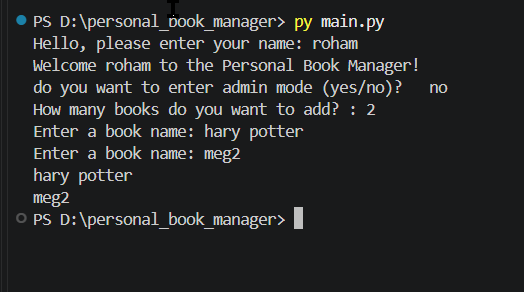

# Personal Book Manager


## Description

Personal Book Manager is a simple book management program built with Python. It allows users to add multiple books, assign priorities, display their book lists, save books in a JSON file, and load them again later. It also includes an Admin Mode with password protection.

## Table of Contents

- [Features](#features)
- [Book Priority](#book-priority)
- [Requirements](#requirements)
- [Project Structure](#project-structure)
- [Installation](#installation)
- [Environment Setup](#environment-setup)
- [Run the Program](#run-the-program)
- [Screenshot / Demo](#screenshot--demo)
- [Usage](#usage)
- [Troubleshooting](#troubleshooting)
- [Author](#author)

## Features

- Add multiple books.
- Assign a priority to each book.
- Display all saved books with their priorities.
- Validate book priorities.
- Save books in a JSON file.
- Load previously saved books.
- Keep old books when adding new books.
- Admin Mode with password protection.

## Book Priority

Each book can have one of three priority levels:

- `low` - Low priority.
- `medium` - Medium priority.
- `high` - High priority.

The program checks the entered priority. If the value is invalid, it asks the user to enter it again.

## Requirements

- Python
- python-dotenv

**Note:** `os` and `json` are built-in Python modules and do not need to be installed separately.

## Project Structure

```text
Personal_Book_Manager/
│
├── main.py             # Main file that runs the program
├── books.py            # Contains functions for managing books
├── books.json          # Stores books and their priorities
├── requirements.txt    # Contains required Python packages
├── .env.example        # Template for environment variables
├── .gitignore          # Prevents sensitive files from being uploaded
├── images/             # Stores project screenshots and images
└── README.md           # Project documentation
```

## Installation

First, clone the repository:

```bash
git clone YOUR_REPOSITORY_LINK
```

Open the project folder:

```bash
cd Personal_Book_Manager
```

Install the required packages:

```bash
pip install -r requirements.txt
```

## Environment Setup

1. Create a file named `.env` inside the project folder.
2. Open `.env.example` to see the required environment variable.
3. Add the following content to your `.env` file:

```env
admin_pass=your_password_here
```

Replace `your_password_here` with your own password.

**Important:**

- Never upload your `.env` file to GitHub.
- Upload `.env.example` to GitHub.
- Make sure `.env` is included in your `.gitignore` file.

## Run the Program

Run the main file using:

```bash
python main.py
```

## Screenshot / Demo



## Usage

1. Enter your name.
2. Choose whether to enter Admin Mode.
3. Enter the admin password if requested.
4. Choose how many books you want to add.
5. Enter each book's name.
6. Enter a priority: `low`, `medium`, or `high`.
7. If the priority is invalid, enter it again.
8. View all saved books and their priorities.

All books are saved in `books.json` and loaded again when the program runs.

## Troubleshooting

### 1. FileNotFoundError

**What does it mean?**

Python cannot